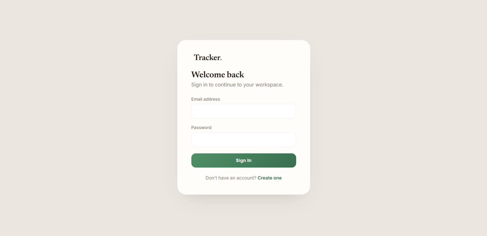

# Certii

A corporate training and certification tracker for employees, managers, and administrators.

## Course Information

| | |
| :--- | :--- |
| Course | Information Management II |
| Program | Information Technology |
| Year Level | 2nd Year |
| Term | Summer |

## About

Certii tracks employee training completion, certification validity, and upcoming renewals. It has three roles, Employee, Manager, and Admin, and each role has its own workspace.

## Features

### Employee

- **Training:** Enroll in and unenroll from courses. Unenrolled users see a blurred, locked preview of the module quiz.
- **Assessments:** Built-in quizzes on compliance and security topics.
- **Certificates:** Passing a quiz shows a confirmation message and generates a Certificate of Completion that can be exported as a PDF.
- **Dashboard:** Shows valid, expiring, and expired certifications, with quick links to contact administration for renewals.

### Manager

- **Team analytics:** Progress bars showing the team's overall completion rate and active enrollments.
- **Activity feed:** The most recently issued team certifications.
- **Compliance reports:** Export team compliance statuses to CSV.

### Admin

- **Course and instructor management:** Create, view, edit, and delete courses and instructors. Deleting an instructor unassigns them from their courses first, so the database does not throw foreign key errors.
- **User management:** Manage employee accounts and roles, and view each employee's training summary.
- **System overview:** Totals for active enrollments, course offerings, and upcoming expirations.

### Interface

- Fixed sidebar navigation
- Responsive layout for mobile screens
- Status badges, modals, and simple state transitions

## Tech Stack

| Layer | Technology |
| :--- | :--- |
| Backend | PHP |
| Database | MySQL via PDO |
| Frontend | HTML, CSS, JavaScript |
| Local server | Laragon (Apache and MySQL) |

## Installation

### Prerequisites

- [Laragon](https://laragon.org/) with Apache and MySQL
- A web browser

### Steps

1. **Copy the project.** Place the `certii` folder in your Laragon `www` directory, for example `C:\laragon\www\certii`. If you already have a project with the same name in `www`, rename one of them.

2. **Import the database.** Open phpMyAdmin or the Laragon MySQL terminal and import `database/schema.sql`. This creates the `corporate_training_db` database, its tables, and the demo accounts listed below.

3. **Start the servers.** Start Apache and MySQL in Laragon.

4. **Open the app.** Go to `http://localhost/certii/`, or `http://certii.test` if Laragon's automatic virtual hosts are enabled.

## Demo Accounts

The password for all three accounts is `password123`. In the database, passwords are stored as bcrypt hashes.

| Role | Email |
| :--- | :--- |
| Administrator | `admin@example.com` |
| Manager | `manager@example.com` |
| Employee | `employee@example.com` |

These accounts are for local testing only. Change or remove them before hosting the project publicly.

## Security

- Each dashboard page checks the user's role before showing anything. Users who open a page outside their role are redirected to their own dashboard.
- Queries that use user input are written as PDO prepared statements to prevent SQL injection.
- Passwords are hashed with `password_hash()` and checked with `password_verify()`.
- Deletion routines remove or unassign related records first to avoid foreign key errors, for example when removing an instructor.
